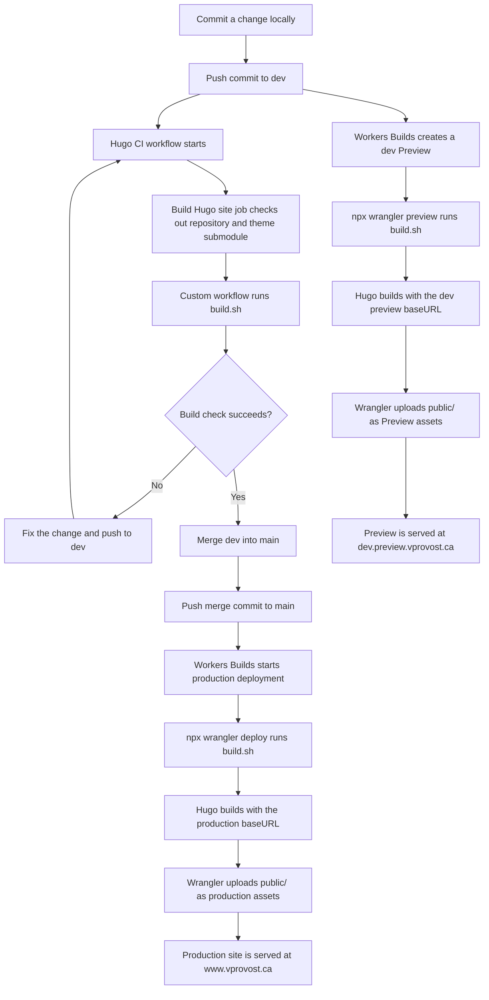

I wanted a personal website that was easy to update without managing a server. This is the setup I landed on: Hugo turns Markdown into a static site, GitHub keeps the source and build instructions together, and Cloudflare Workers publishes the generated files.

Each tool has one clear job. Here is the path from an edit to a live page:



This guide walks through the pieces in the order I put them together.

## 1. Start with Hugo

Hugo is the content and build layer. Posts are Markdown files under `content/posts/`; Hugo combines them with a theme and writes the finished site to `public/`.

The core settings in my `hugo.toml` look like this:

```toml
baseURL = "https://www.vprovost.ca"
defaultContentLanguage = "en"
defaultContentLanguageInSubdir = true
theme = "hermit-v2"
```

The language setting puts the English site under `/en/`. The public `baseURL` gives Hugo the hostname to use for canonical links and generated URLs.

I use Hermit-V2 as a Git submodule rather than copying the theme into the project:

```sh
git submodule add https://github.com/1bl4z3r/hermit-V2.git themes/hermit-v2
```

The repository records the theme commit, so a build uses a known version of the theme. That is useful in a clean deployment checkout, where the submodule has to be initialized explicitly.

## 2. Write and preview a post

Each post is a Markdown file with YAML front matter (If you've ever taken notes with Obsidian, this will be very familiar). The front matter controls the URL, publication date, draft status, tags, and description. For example:

```yaml
---
title: "My First Post"
date: 2026-11-05
draft: true
description: "A short summary for the post list."
tags: [hugo, web]
---
```

While writing, I preview the site locally:

```sh
hugo server -D
```

The `-D` flag includes drafts. When a post is ready to publish, I change `draft` to `false` and verify it with a production build. Hugo Extended is required because the theme compiles SCSS.

## 3. Keep the source in GitHub

The repository contains the content, Hugo configuration, Wrangler configuration, and `build.sh`. The theme is tracked as a submodule. This keeps the deploy reproducible: Workers Builds can check out the repository, initialize the theme, and run the same instructions from a clean environment.

There is one cross-platform detail worth getting right: Linux paths are case-sensitive. The Hugo theme name, `.gitmodules` path, and directory in `themes/` must use the same spelling. A case mismatch can go unnoticed on Windows and fail when the Linux build tries to find the theme.

### The GitHub Actions build check

The `Hugo CI` workflow in `.github/workflows/hugo-ci.yml` checks the site on pushes and pull requests targeting `dev` or `main`. Its `Build Hugo site` job checks out the repository with its theme submodule, then runs `build.sh`. A successful check lets me merge the tested changes from `dev` into `main`; Cloudflare Workers Builds handles the separate preview and production deployments.

```yaml
name: Hugo CI

on:
  push:
  pull_request:
    branches: [dev, main]
  workflow_dispatch:

jobs:
  build:
    name: Build Hugo site
    runs-on: ubuntu-latest
    steps:
      - name: Check out repository and theme
        uses: actions/checkout@v4
        with:
          submodules: recursive
          fetch-depth: 0

      - name: Build site
        run: |
          chmod +x build.sh
          ./build.sh
```

## 4. Make the build repeatable

Workers Builds runs `npx wrangler deploy`. In this project, that command calls `build.sh`, which installs the required tools, initializes the theme, installs Node dependencies, and builds the site.

The script pins tool versions at the top. One important choice is downloading the Extended Hugo archive, not the standard archive:

```bash
HUGO_VERSION=0.169.0

curl -sfL --output-dir "${build_temp_dir}" -O \
  "https://github.com/gohugoio/hugo/releases/download/v${HUGO_VERSION}/hugo_extended_${HUGO_VERSION}_linux-amd64.tar.gz"
mkdir -p "${HOME}/.local/hugo"
tar -C "${HOME}/.local/hugo" -xf \
  "${build_temp_dir}/hugo_extended_${HUGO_VERSION}_linux-amd64.tar.gz"
```

Then the build initializes the submodule and creates the production output:

```bash
if [[ -f .gitmodules ]]; then
  git submodule update --init --recursive
fi

if [[ -f package-lock.json ]]; then
  npm ci
fi

hugo build --gc --minify
```

The output is written to `public/`, ready for Wrangler to publish.

## 5. Tell Wrangler what to build and publish

The relevant parts of `wrangler.jsonc` connect the deploy command to the generated assets and custom domain:

```jsonc
{
  "build": {
    "command": "chmod a+x build.sh && ./build.sh"
  },
  "assets": {
    "directory": "./public",
    "not_found_handling": "404-page"
  },
  "routes": [
    { "pattern": "www.vprovost.ca", "custom_domain": true }
  ]
}
```

Hugo runs during the build, not on each page request. Wrangler deploys the generated files as Worker assets, and Cloudflare serves them from the edge. Workers Builds connects the GitHub repository to this process, so pushing a change starts a fresh build and deployment.

## 6. Deploy and verify

My day-to-day loop is short:

1. Write or edit a post in `content/posts/`.
2. Preview it with `hugo server -D`.
3. Set `draft: false` when it is ready to publish.
4. Push the change to GitHub and check the Workers Builds log.

If the deploy fails, the build log helps separate site errors from hosting and DNS errors. I hit a Linux case-sensitivity issue with the theme path and a missing Hugo Extended binary. Later, a local DNS override returned `1.1.1.1` for the site; public DNS and the Worker were healthy, but that local answer caused Cloudflare Error 1034. A failed browser request does not always mean the Hugo build or Worker is broken.

The result is a simple publishing pipeline: Markdown is the source, Hugo produces the site, GitHub tracks and triggers the build, and Cloudflare Workers serves the output. I can focus on writing and let the pipeline handle the rest.
