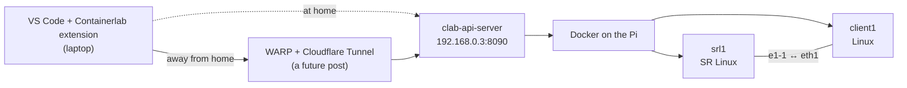

I wanted a network lab I could open from my laptop, without turning my laptop into a data centre. So the lab runs on a Raspberry Pi 5 at home, and VS Code on the laptop drives it. I draw a topology, hit deploy, and a Nokia SR Linux switch boots on a computer I could lose in a drawer.

Here's how a request gets from my laptop to a running lab:



Two containers do the real work: containerlab and its API server. Everything else is plumbing to reach them.

**What you need:** a Raspberry Pi 5 (or any arm64 or x86 Linux box) running a 64-bit OS, with Docker Engine and the Compose plugin installed, and a user with `sudo`. Mine runs Ubuntu 26.04. For the laptop side, you need VS Code.

## 1. Why a Pi, and why a remote lab host

[Containerlab](https://containerlab.dev) builds network labs out of containers. You describe nodes and links in a YAML file, and it starts the containers and wires them together with virtual cables. It wants Linux, Docker and root, which is a lot to ask of a laptop.

In November 2026, version 0.27.0 of the [Containerlab VS Code extension](https://marketplace.visualstudio.com/items?itemName=srl-labs.vscode-containerlab) added **Lab Hosts**. The extension can now manage labs on a remote machine running [clab-api-server](https://github.com/srl-labs/clab-api-server). Your laptop doesn't need containerlab or Docker at all, just a URL and a login.

The Pi was the obvious place to put it. It's always on, it's on my LAN, and it already runs my other self-hosted services. And yes, it runs SR Linux: Nokia publishes the image for arm64, and so do the other images here. That also means none of this is Pi-specific. The same files work on an x86 box.

## 2. Where things live

Every service on this Pi lives in `/opt/docker/<service>`: `cloudflared`, Pi-hole, a reverse proxy, and now containerlab. I keep the containerlab project in my home directory and symlink it into place so it sits with the others:

```bash
sudo ln -s /home/van/projects/containerlabs /opt/docker/containerlabs
```

The project is four files, and the rest of this post walks through each one:

```text
/opt/docker/containerlabs/
├── docker-compose.yml              # containerlab + its API server
├── .env                            # this host's values and the API secret (mode 600)
├── .env.example                    # what .env should contain
└── containerlab-template.clab.yml  # the starter lab
```

## 3. The compose file

Containerlab is normally installed straight onto the host. I run it in a container instead, so the Pi stays clean and an upgrade is a new image tag. I pin the tags so an upgrade only happens when I decide it should.

`docker-compose.yml`:

```yaml
services:
  # Interactive containerlab shell (no restart policy on purpose).
  clab-core:
    image: ghcr.io/srl-labs/clab:0.83.0
    container_name: containerlab-core
    command: bash
    stdin_open: true
    tty: true
    # Privileged + host network + host PID: lab nodes are created as sibling
    # containers and wired together with veth links in the host's namespaces.
    privileged: true
    network_mode: host
    pid: host
    volumes:
      - /var/run/docker.sock:/var/run/docker.sock
      - /var/run/netns:/var/run/netns
      - /etc/hosts:/etc/hosts
      - /var/lib/docker/containers:/var/lib/docker/containers:ro
      - type: bind
        source: .
        target: /opt/docker/containerlabs
    working_dir: /opt/docker/containerlabs

  # REST API server. Reads API_SERVER_HOST and JWT_SECRET from .env.
  clab-api:
    image: ghcr.io/srl-labs/clab-api-server/clab-api-server:v0.10.0
    container_name: containerlab-api-server
    restart: unless-stopped
    privileged: true
    network_mode: host
    pid: host
    environment:
      - LOG_LEVEL=info
      - API_PORT=8090
      - API_SERVER_HOST=${API_SERVER_HOST:?set API_SERVER_HOST in .env}
      - JWT_SECRET=${JWT_SECRET:?set JWT_SECRET in .env}
    volumes:
      - /var/run/docker.sock:/var/run/docker.sock
      - /var/run/netns:/var/run/netns
      - /var/lib/docker/containers:/var/lib/docker/containers
      # Host accounts are used for login; read-only so the API can't change them.
      - /etc/passwd:/etc/passwd:ro
      - /etc/shadow:/etc/shadow:ro
      - /etc/group:/etc/group:ro
      - /etc/gshadow:/etc/gshadow:ro
      # With CLAB_LABS_ROOT unset, API-managed labs are written to each user's ~/.clab.
      - /home:/home
      - /var/lib/clab-api-server:/var/lib/clab-api-server
```

`clab-core` is a shell with the `containerlab` command in it. It doesn't run labs itself. Through the Docker socket, it asks the host's Docker to start each lab node as an ordinary container next to it. Then it wires the nodes together with veth pairs (virtual cables) inside the host's network namespaces. That's why it needs `privileged`, the host's network and PID namespaces, and `/var/run/netns`. Containerlab also writes each node's name into `/etc/hosts`, so the host's copy is mounted in. It has no restart policy because it's just a shell. I don't want it coming back on its own after a reboot.

The project folder is mounted at `/opt/docker/containerlabs` inside the container too. Any path containerlab prints is a path I can open on the Pi.

`clab-api` needs the same privileges for the same reasons, plus the host's account files for logins (more on that in section 4). It mounts `/home` read-write because labs deployed through the API land in each user's `~/.clab`. `CLAB_LABS_ROOT` is the setting that would put them somewhere else; I left it unset. The two values that change from host to host come from `.env`.

`.env.example`:

```bash
# Copy to .env (cp .env.example .env) and fill it in.

# This host's LAN IP or hostname, as clients will reach it.
API_SERVER_HOST=192.168.0.3

# Required. Generate one with: openssl rand -hex 32
JWT_SECRET=
```

The `${VAR:?message}` syntax makes Compose refuse to start when either value is empty. The server's installer would normally generate `JWT_SECRET` for you, but running the container directly skips the installer. Without the guard, it's easy to never set one.

To set it up (I use `sudo` with Docker because my user isn't in the `docker` group):

```bash
cd /opt/docker/containerlabs
cp .env.example .env && chmod 600 .env
sed -i "s/^JWT_SECRET=.*/JWT_SECRET=$(openssl rand -hex 32)/" .env
sudo docker compose up -d
```

If you ever want to drive containerlab by hand, open a shell in `clab-core`. It starts in the project folder:

```bash
sudo docker exec -it containerlab-core bash
containerlab deploy -t containerlab-template.clab.yml
containerlab inspect -t containerlab-template.clab.yml
containerlab destroy -t containerlab-template.clab.yml
```

Most of the time, though, VS Code does all of this through the API.

## 4. Logging in: your Linux account is the account

The API server doesn't keep its own users. It reads the host's `/etc/passwd` and `/etc/shadow` and checks your normal Linux username and password. A successful login gets you a token, signed with `JWT_SECRET`, which lasts 24 hours by default.

You can only sign in if you're in one of two groups:

- `clab_api`: regular users, who run their own labs.
- `clab_admins`: superusers, who can see and run everyone's labs.

The server's installer creates these groups. I skipped the installer, so I made them myself. The API starts fine without them; logins just fail until they exist.

```bash
sudo groupadd clab_api
sudo groupadd clab_admins
sudo usermod -aG clab_api "$USER"
```

My user still isn't in the `docker` group, and it doesn't need to be. The API server talks to Docker for me.

The server uses HTTPS on port 8090 by default, with a self-signed certificate it generates itself. You can test a login from the Pi before touching VS Code (`-k` tells curl to accept the self-signed certificate):

```bash
curl -sk -X POST https://192.168.0.3:8090/login \
  -H 'Content-Type: application/json' \
  -d '{"username":"van","password":"<your password>"}'
```

If you get JSON back with a token, the server, the groups and your password all work. There's also a browsable API at `https://192.168.0.3:8090/swagger/index.html`.

## 5. The template lab

The starter lab is about as small as a lab gets: one SR Linux node and one Linux client, joined by one virtual cable.

`containerlab-template.clab.yml`:

```yaml
name: containerlab-template

mgmt:
  # auto picks a subnet that does not collide with existing Docker networks
  ipv4-subnet: auto

topology:
  nodes:
    srl1:
      kind: nokia_srlinux
      type: ixr-d1
      image: ghcr.io/nokia/srlinux:26.7.2
    client1:
      kind: linux
      image: ghcr.io/srl-labs/network-multitool:v0.10.0

  links:
    - endpoints: ["srl1:e1-1", "client1:eth1"]
```

`srl1` is Nokia's SR Linux. The image is free to download, and without a licence it's rate-limited, which a lab this size never notices. `type: ixr-d1` picks the hardware model it emulates, one of Nokia's 7220 IXR data-centre switches. `client1` is a Linux container packed with network tools. The link connects the switch's first port, `e1-1`, to the client's `eth1`.

That `ipv4-subnet: auto` line is there because my first deploy failed without it. Containerlab puts every node's management interface on a Docker network, and by default that network is `172.20.20.0/24`. My Pi already had nine Docker bridge networks, counting Docker's default `docker0`, and Docker hands them out as `/16`s from `172.17.0.0` up. One of them was `172.20.0.0/16`, and `172.20.20.0/24` sits right inside it. So containerlab's default network collided with one I already had, and the deploy stopped there.

With `auto`, Docker picks a management subnet that doesn't clash with anything already on the host. A lab shouldn't have to know what else the host is running.

## 6. VS Code: adding the Pi as a Lab Host

On the laptop:

1. Install the Containerlab extension (0.27.0 or later).
2. Open the Command Palette and run **Containerlab: Manage Lab Hosts**.
3. Add a host with the URL `https://192.168.0.3:8090`. It has to be `https://`, since that's what the server speaks.
4. Sign in with your Linux username and password.

The extension keeps the sign-in token in VS Code's secret storage, not in `settings.json`. It didn't warn me about the self-signed certificate. I haven't dug into whether it checks certificates at all.

After that, the Pi shows up in the Containerlab explorer next to any local labs, tagged **API · Docker**, with its labs grouped as running or undeployed. Opening one shows it in TopoViewer:


The play button deploys the lab on the Pi, and its files land in `~/.clab` in my home directory there.

All of this works on my LAN. When I'm away from home, I reach the Pi with Cloudflare's WARP client and a Cloudflare Tunnel, without opening a port on my router. That setup deserves its own post, and I'll be writing a guide on it soon.

## 7. Before you copy this

- **Change the values that are mine.** `192.168.0.3` is my Pi's address. Put yours in `.env` and in VS Code. `van` in the examples is my username.
- **These containers are root on the host.** Both run privileged with the Docker socket mounted. Keep port 8090 on your LAN, and reach it from outside through something private like a VPN or a tunnel. Don't forward it on your router.
- **Changing `JWT_SECRET` signs everyone out.** Old tokens stop working, and tokens expire after 24 hours anyway. Sign in again from **Manage Lab Hosts**.

My first deploy took under ten minutes, start to finish. Not bad for a computer smaller than my phone.
